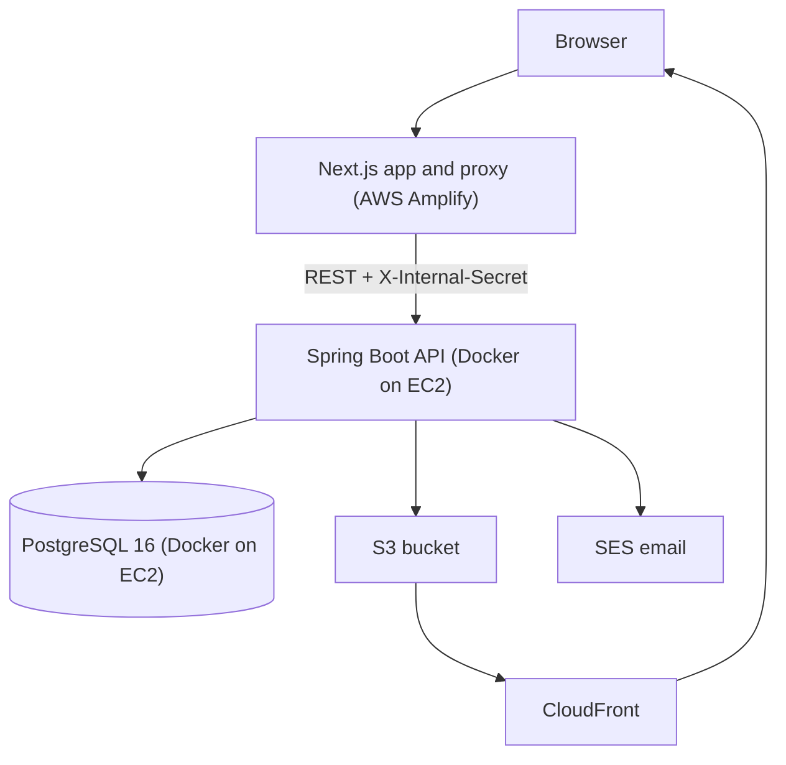

# edens.zac.backend

[](https://github.com/themancalledzac/edens.zac.backend/actions/workflows/ci-cd.yml)
[](LICENSE)

REST API behind a photography portfolio. It stores images and collections in PostgreSQL, serves the media from S3 through CloudFront, and handles sign-in, client galleries, share links and per-user saves.

The frontend is a separate Next.js app, [edens.zac](https://github.com/themancalledzac/edens.zac). Every browser request goes through its server-side proxy, never straight to this API.

---

## Tech Stack

| Layer | Technology |
|---|---|
| Runtime | Java 23, Spring Boot 3.5 |
| Database | PostgreSQL 16, Flyway migrations |
| Data access | JDBC via `NamedParameterJdbcTemplate` and hand-written SQL (no JPA) |
| Auth | Spring Security, DB-backed sessions, passwords (bcrypt) and passkeys (webauthn4j) |
| Media | AWS S3, CloudFront with Origin Access Control |
| Image processing | Thumbnailator, metadata-extractor (EXIF), webp-imageio, ffmpeg for video |
| Email | AWS SES v2 |
| Hosting | Docker Compose on AWS EC2, infrastructure in Terraform |
| CI | GitHub Actions: Checkstyle, tests, Maven and Docker build |
| Code style | google-java-format via Spotless, Checkstyle |
| Testing | JUnit 5, Mockito, AssertJ, MockMvc, Testcontainers |

Exact versions live in [pom.xml](pom.xml).

---

## What It Does

- **Collections.** A collection is a named, slugged, ordered list of any mix of images, text, GIFs, videos and other collections. Two stored flags change how it behaves: `isClient` (password-gated client gallery) and `isBlog` (shown in blog listings). Parent collections and the home page are worked out from the content graph and the `home` slug.
- **Image upload.** Uploads run through a parallel pipeline that writes several WebP sizes to S3 and reads EXIF data (camera, lens, exposure, GPS). Large imports from local disk run as background jobs with a status endpoint.
- **GIF and video.** MP4, MOV and GIF uploads get a first-frame thumbnail from ffmpeg.
- **Search and metadata.** Images can be filtered by tag, person, camera, lens, location, rating, film or digital, and date range. Tags, people, cameras, lenses, locations and film stocks are managed as metadata, with batch edits.
- **Users and access.** Users sign in with a password or a passkey. Admins invite users, assign roles, and grant roles access to collections. Collaborators can reorder and edit collections they can reach.
- **Sharing.** Client galleries unlock with a password and a short-lived HMAC token. Users can create share links to collections, and share links can be emailed.
- **Per-user data.** Signed-in users can save images, follow collections, mark selects, and override ratings.
- **Downloads.** Single images and whole collections can be downloaded.
- **Contact messages.** A public, rate-limited contact form. Admins read and delete messages, and old ones are purged on a schedule.

---

## Architecture



- **Controllers** are grouped by who may call them (see [API Routes](#api-routes)). They return DTOs, never entities. `GlobalExceptionHandler` turns exceptions into error responses, so controllers have no try-catch.
- **Services** are concrete `*Service` classes with no interface/impl split.
- **DAOs** run hand-written SQL through `NamedParameterJdbcTemplate`.
- **Security.** In the `prod` profile, `InternalSecretFilter` rejects any request without the proxy's shared secret, except the actuator health checks. `SecurityConfig` then checks the caller's role per route group. Startup guards (`config/Prod*Guard.java`) stop a prod boot that is missing required secrets.

---

## Project Structure

```
src/main/java/edens/zac/portfolio/backend/
  controller/
    prod/       Public reads (/api/read/**), plus signed-in user routes (/api/read/user/**)
    user/       Signed-in user rating overrides
    pub/        Anonymous writes (/api/public/**), currently the contact form
    auth/       Login, logout, passkeys, invites (/api/auth/**)
    edit/       Collaborator writes (/api/edit/**)
    admin/      Admin routes (/api/admin/**)
  services/     Business logic
  dao/          JDBC data access
  entity/       Plain data classes (*Entity)
  model/        DTOs, requests, responses
  types/        Enums
  config/       Security, filters, interceptors, startup guards
src/main/resources/
  db/migration/ Flyway SQL migrations
terraform/      AWS infrastructure (EC2, S3, CloudFront, IAM, security groups)
scripts/        Database tunnel, backup and restore, EC2 setup
deploy.sh       Deploy script, run on the EC2 host
```

---

## API Routes

Routes are grouped by URL prefix. Each prefix maps to one access level.

| Prefix | Who can call it | Covers |
|---|---|---|
| `/api/read/**` | Anyone | Collections, collection metadata, location pages, image search, metadata lists, downloads, share-link views, gallery password check |
| `/api/read/user/**` | Signed-in users | Saves, follows, selects, rating overrides, share links, the user's own page |
| `/api/public/**` | Anyone, rate-limited | Contact form |
| `/api/auth/**` | Anyone for login and invites, signed-in users for the rest | Password and passkey login, invite accept, logout, current user, passkey registration |
| `/api/edit/**` | Collaborators and admins | Reorder, rate, and edit collections and their images |
| `/api/admin/**` | Admins | Uploads and import jobs, collections, metadata, users, roles, gallery access, messages, request metrics, cache |

The controllers in `controller/` are the full list of endpoints.

---

## Getting Started

### Prerequisites

- Java 23
- Docker (the tests start PostgreSQL with Testcontainers)
- Access to a PostgreSQL 16 database: the EC2 instance through an SSH tunnel, or a local one
- AWS credentials with access to the S3 bucket

Maven is not required. Use the included `./mvnw` wrapper.

### Run locally

1. Clone and build:
   ```bash
   git clone https://github.com/themancalledzac/edens.zac.backend.git
   cd edens.zac.backend
   ./mvnw clean install
   ```

2. Create `.env` from the example and fill it in. Each variable is described in [.env.example](.env.example).
   ```bash
   cp .env.example .env
   ```

3. Open a tunnel to the EC2 database (skip this when using a local PostgreSQL):
   ```bash
   ./scripts/db-tunnel.sh up
   ```

4. Start the API with the `dev` profile:
   ```bash
   ./mvnw spring-boot:run -Dspring-boot.run.profiles=dev
   ```

The API listens on `http://localhost:8080`.

In the `dev` profile, `DevLocalAdminFilter` treats local callers as the bootstrap admin, so the admin UI works without signing in. Keep the port bound to localhost.

### Run with Docker

```bash
docker compose up --build
```

Set `BACKEND_BIND_ADDR=127.0.0.1` in `.env` so the port is not reachable from your network. The compose file runs only the backend. It connects to a PostgreSQL instance that runs separately.

---

## Build and Test

```bash
./mvnw clean install          # Build and run tests
./mvnw test                   # Run tests only
./mvnw spotless:apply         # Format code
./mvnw checkstyle:check       # Check style
```

CI runs Checkstyle, the test suite and a Docker build on every push.

The repo's `.vscode/settings.json` runs `spotless:apply` on save if the [Run On Save](https://marketplace.visualstudio.com/items?itemName=emeraldwalk.RunOnSave) extension is installed.

---

## Environment Variables

[.env.example](.env.example) lists every variable with a description. The ones the app cannot start without in prod:

| Variable | Purpose |
|---|---|
| `SPRING_PROFILES_ACTIVE` | `dev` locally, `prod` on EC2 |
| `POSTGRES_HOST`, `POSTGRES_PORT`, `POSTGRES_DB`, `POSTGRES_USER`, `POSTGRES_PASSWORD` | Database connection |
| `AWS_ACCESS_KEY_ID`, `AWS_SECRET_ACCESS_KEY` | AWS credentials |
| `AWS_PORTFOLIO_S3_BUCKET` | S3 bucket for media |
| `AWS_CLOUDFRONT_DOMAIN`, `AWS_CLOUDFRONT_DISTRIBUTION_ID` | CloudFront domain for media URLs, and the distribution to invalidate on delete |
| `INTERNAL_API_SECRET` | Shared secret the Next.js proxy sends on every request |
| `ACCESS_TOKEN_SECRET` | Encrypts share-link tokens and signs gallery access tokens |
| `WEBAUTHN_RP_ID`, `WEBAUTHN_RP_NAME`, `WEBAUTHN_ALLOWED_ORIGINS` | Passkey settings for the real domain |
| `EMAIL_ENABLED`, `EMAIL_FROM_ADDRESS`, `EMAIL_FRONTEND_BASE_URL` | SES email and the site URL used in email links |

---

## Deployment

Deploys are manual. SSH to the EC2 host and run:

```bash
bash ~/portfolio-backend/repo/deploy.sh
```

The script pulls `main`, checks the server `.env` against the prod startup guards, builds the image, swaps the container and waits for `/actuator/health`. If the new container never becomes healthy, it restarts the previous image.

See [ai_docs/ai_deployment_strategy.md](ai_docs/ai_deployment_strategy.md) for the full guide, including backups and HTTPS.

---

## License

[MIT](LICENSE)
